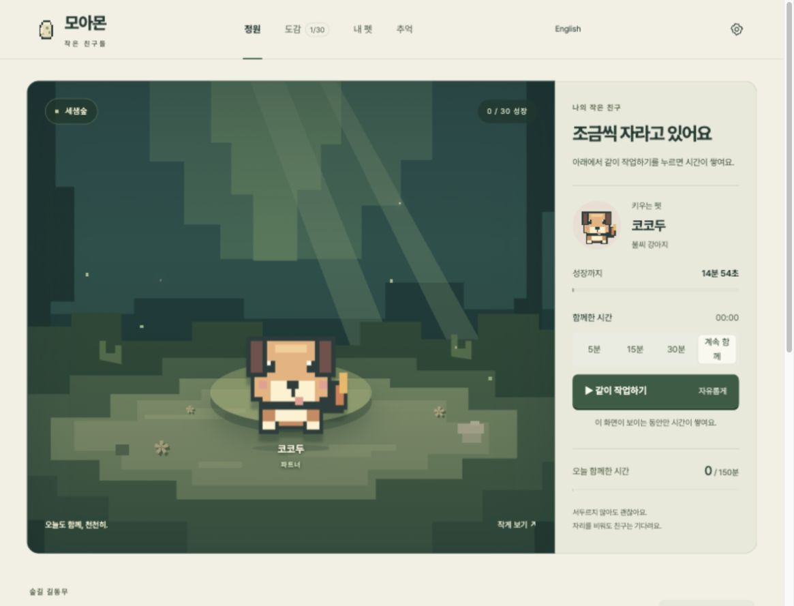
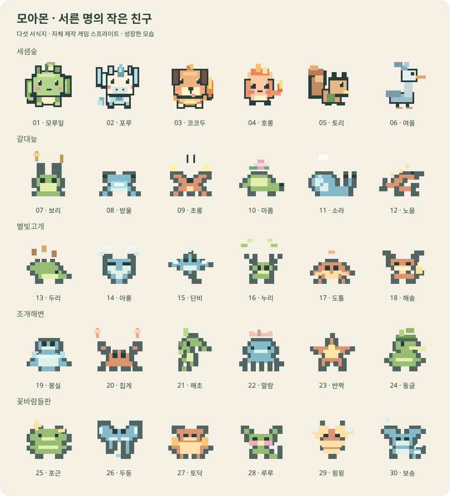

<div align="center">

[English](README.md) · **한국어**

# 모아몬

**같이 작업하는 동안, 작은 친구가 자라요.**

알을 고르고, 친구를 만나고, 둘만의 이야기로 정원을 채워 보세요.

[**한국어로 시작 ↗**](https://dayainow.github.io/lorehatch/?lang=ko) · [**30초 성장 체험**](https://dayainow.github.io/lorehatch/?lang=ko&mode=demo) · [**깃허브에서 별 남기기 ☆**](https://github.com/dayainow/lorehatch)

**웹 알파 · 30종 · 한국어와 영어 지원 · 기기 안에 저장**

</div>



## 다음 쉬는 시간에는 작은 친구가 기다려요

모루잎은 햇볕에 잎날개를 펴고, 포루는 조심스러운 착지를 연습해요. 코코두는 따뜻한 코로 손바닥에 인사합니다.

첫 알은 바로 부화해요. **같이 작업하기**를 누르고 정원을 열어 두면 **15분** 만에 아기 친구가 성장합니다. 다음 알은 **5분**이면 부화해요. 배고픔이나 연속 출석 때문에 조급해할 필요는 없어요. 하루 쉬어도 친구는 기다립니다.

**알 선택 → 부화 → 같이 작업하기 → 성장 → 친구 이야기 발견**

## 서른 친구, 다섯 서식지

- **30종, 60가지 모습.** 모든 친구에게 아기와 성장한 모습이 있어요. 성장 단계는 별도 종으로 세지 않습니다.
- **다섯 서식지.** 각 서식지의 여섯 친구를 성장시키면 다음 알이 열려요. 세샘숲, 갈대늪, 별빛고개, 조개해변, 꽃바람들판으로 이어집니다.
- **친구 이야기 15편.** 짝인 두 친구를 성장시키고 각각 돌보면 함께하는 결말을 발견해요.
- **추억 카드 30장.** 짧은 선택형 만남에서 친구를 도와주세요. 틀려도 불이익 없이 다시 고를 수 있어요.
- **수집 목표 14개.** 정원이 확장되어도 이전에 달성한 목표는 그대로 유지됩니다.



120종은 장기 목표입니다. **이번 알파는 30종**이며 부화 후 한 번 성장합니다. 전투와 분기 진화는 아직 없습니다.

## 처음 몇 분, 이렇게 함께해요

1. [한국어 정원](https://dayainow.github.io/lorehatch/?lang=ko)에서 불·물·풀 중 첫 알을 골라요.
2. 친구를 부화시키고 **같이 작업하기**를 눌러요. **계속 함께**는 일시정지하거나 성장이 준비될 때까지 이어집니다.
3. 도감에서 돌봄 반응을 발견하고, 추억 메뉴에서 작은 부탁을 들어주세요.
4. 성장한 모습을 확인하고 다시 돌봐 주세요. 관계 힌트에 등장하는 다음 친구를 찾아보세요.

[빠른 체험](https://dayainow.github.io/lorehatch/?lang=ko&mode=demo)은 일반 정원과 따로 저장되며, 부화 15초·성장 30초입니다. 일반 정원은 하루 최대 150분이 성장에 반영됩니다.

**수동 작업 시간은 정원이 보이고 세션이 실행 중일 때만 쌓입니다.** 다른 탭으로 이동하거나 창을 숨기거나 잠자기에 들어가면 멈춥니다. 컴퓨터 사용량에 따른 백그라운드 자동 성장은 아직 구현하지 않았습니다.

## 언어를 바꿔도 정원은 그대로

화면 위 언어 버튼으로 한국어와 영어를 바꿀 수 있어요. 메뉴, 도감, 돌봄 반응, 만남, 추억, 설정이 선택한 언어를 따릅니다. 수집 진행과 직접 지은 별명은 바뀌지 않아요. 첫 방문은 브라우저 언어를 따르며, 언어가 지정된 링크는 해당 언어로 열립니다.

## 체험과 다운로드

[**웹 알파 열기**](https://dayainow.github.io/lorehatch/?lang=ko) · [**배포 파일 확인**](https://github.com/dayainow/lorehatch/releases) · [**소스 압축 파일**](https://github.com/dayainow/lorehatch/archive/refs/heads/main.zip)

첫 공개 경로는 웹 알파입니다. 웹 압축 파일은 직접 호스팅하기 위한 정적 사이트 묶음이며, 데스크톱 설치 파일이 아닙니다. 소스 압축 파일에는 개발 코드가 들어 있습니다.

**맥 개발 빌드:** 바탕화면 친구, 메뉴바 조작, 크기와 위치 저장, 로컬 저장 복구를 구현했습니다. 로컬 범용 패키지는 맥 운영체제 13 이상에서 애플 실리콘과 인텔을 대상으로 합니다. 현재 임시 서명 상태이며 **개발자 배포 서명과 애플 공증은 받지 않았습니다.** 일반 사용자용 맥 설치본으로 공개하지 않았고 앱스토어에도 등록되지 않았습니다.

개발 코드를 실행하려면 노드제이에스 22 이상에서 다음 명령을 사용하세요.

```sh
git clone https://github.com/dayainow/lorehatch.git
cd lorehatch
npm run dev
```

[로컬 정원](http://127.0.0.1:4173/?lang=ko)을 여세요. 게임 실행용 추가 패키지 설치는 필요하지 않습니다.

<details>
<summary>빌드와 검증</summary>

```sh
npm test
npm run check
npm run build
npm run package:web
```

사이트는 `dist/`, 웹 압축 파일은 `release/`에 생성됩니다. 압축에는 `zip`과 `unzip` 명령이 필요합니다.

맥에서 엑스코드 명령줄 도구를 설치한 뒤 실행하세요.

```sh
npm run package:mac
```

앱은 `build/desktop/Lorehatch.app`에 생성됩니다. 저장소와 내부 식별자는 `lorehatch`, 제품 이름은 모아몬입니다.

</details>

## 나의 정원은 내 기기에

진행은 기기에 저장됩니다. 로그인이나 자동 클라우드 동기화는 없습니다. 기기·브라우저·설치본을 바꾸기 전에 설정에서 파일을 내보내고, 새 정원의 같은 모드로 가져오세요.

작업 내용·키 입력·클립보드를 수집하지 않으며 분석 추적 도구도 없습니다. 호스팅 제공자는 일반 접속 로그를 처리할 수 있어요. 공유 카드에는 별명과 작업 시간을 포함하지 않습니다.

로컬 맥 빌드에는 **클로드 코드 완료 신호 연동 실험 기능**도 있습니다. 대화와 토큰 대신 완료 시각만 읽습니다. 별도 설정이 필요하며 실제 공급자 세션 검증은 남아 있어요. [설정과 제한](docs/24-ai-activity.md).

## 알파 검증과 남은 작업

자동 검사로 성장, 저장 복구·이전 버전 호환, 전체 수집, 돌봄, 추억, 오프라인 화면, 번역 누락을 확인합니다. 브라우저에서는 영어 부화·돌봄·추억 획득, 언어 전환, 도감 탐색을 확인했습니다. 고객 검증이나 모든 기기에서의 동작을 보장하는 것은 아닙니다.

일반 사용자용 맥 출시 전에는 개발자 서명·공증, 네이티브 플레이테스트 확대, 실제 인공지능 도구 연동 검증이 남아 있습니다. 백그라운드 성장은 별도의 제품 개선 항목입니다.

문제나 만나고 싶은 친구가 있다면 [의견을 남겨주세요](https://github.com/dayainow/lorehatch/issues). 사용 기기와 재현 순서를 적고, 개인 저장 파일은 공개 이슈에 첨부하지 마세요.

## 제작과 출처

스프라이트는 직접 작성한 픽셀 에셋입니다. 전승 모티프와 정원의 창작 설정을 구분하며 다른 게임의 그림이나 스프라이트는 포함하지 않습니다. 프리텐다드 글꼴은 [글꼴 사용 허가문](assets/fonts/OFL.txt)을 따릅니다.

프로젝트 전체의 오픈소스 라이선스는 아직 미선정입니다. 저장소 공개가 코드·캐릭터의 재배포 권한을 뜻하지는 않습니다. 모아몬은 가칭이며 상표 권리가 확인되었다는 뜻은 아닙니다.

소개 구성은 [코드 편집기 속 펫 프로젝트](https://github.com/tonybaloney/vscode-pets), [데스크톱 펫 프로젝트](https://github.com/Adrianotiger/desktopPet), [포켓토큰바](https://github.com/chattymin/PokeTokenBar)를 참고했습니다. 그림과 문구는 가져오지 않았습니다.

---

**작은 알 하나. 나만의 친구. 다시 돌아올 이유.**
