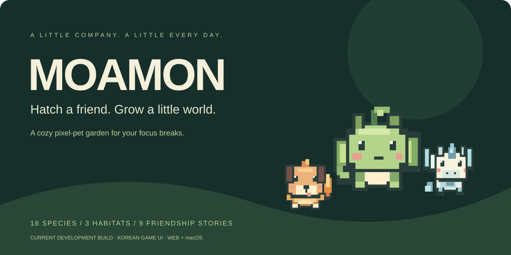
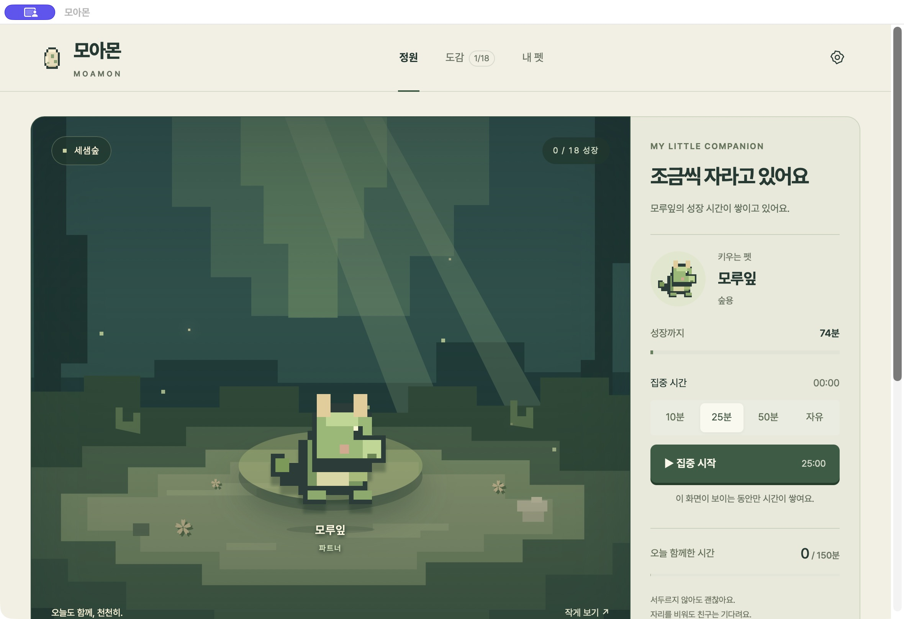
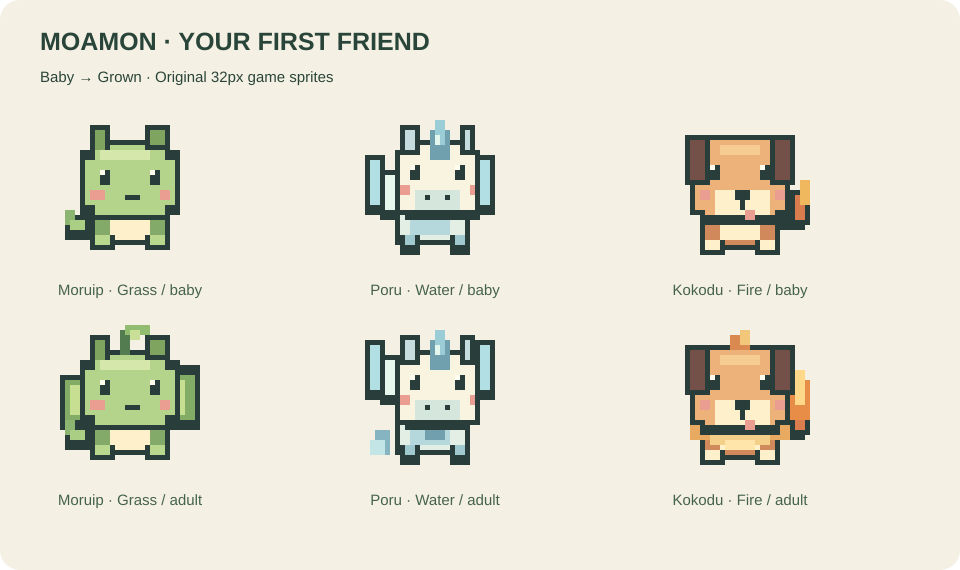
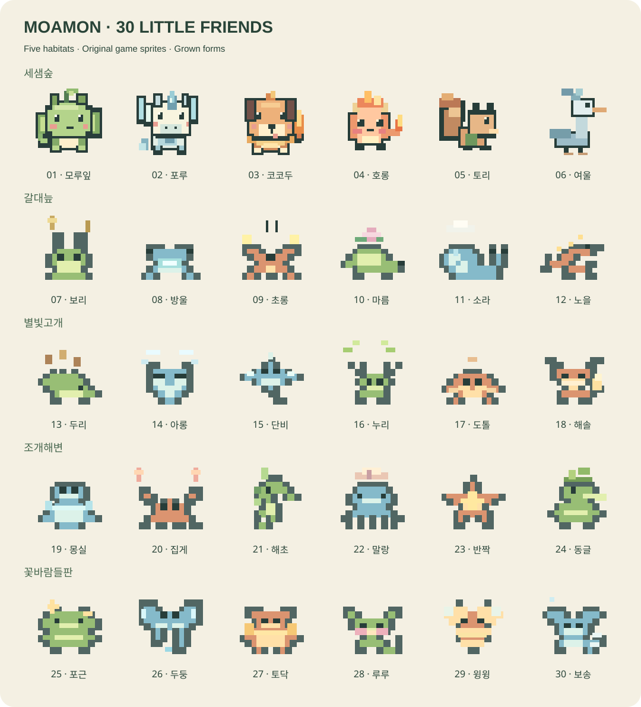
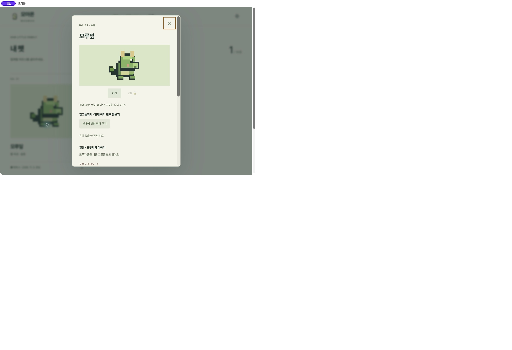

<div align="center">

[English](README.md) · **한국어**

# 모아몬 · Moamon

**작은 알 하나에서, 함께 돌아오고 싶은 정원으로.**

마음에 드는 알을 고르고, 집중하는 동안 친구를 키우세요.<br>
작은 반응과 친구 사이의 이야기를 발견하는 도트 펫 정원입니다.

[**브라우저 알파 시작 ↗**](https://dayainow.github.io/lorehatch/) · [**다운로드와 실행 ↓**](#다운로드와-실행) · [**GitHub Star ☆**](https://github.com/dayainow/lorehatch)

</div>





<sub>이전 UI 촬영 화면입니다. 최신 스타터 모습은 아래 비교 그림을 참고하세요.</sub>

## 다음 쉬는 시간에는 작은 친구가 기다려요

햇볕에 잎날개를 펴는 숲용, 착지를 연습하는 페가수스, 숯빛 귀와 불씨 꼬리를 흔드는 아기 강아지. 첫 알은 기다림 없이 부화합니다. 정원을 열어 두고 집중을 시작하면 선택한 친구가 조금씩 자라요.

**알 선택 → 부화 → 함께 집중 → 성장 → 친구 이야기 발견**

배고픔이나 연속 출석 때문에 조급해할 필요는 없어요. 하루 쉬어도 친구는 기다립니다.

## 세 개의 알, 서로 다른 첫 친구

- **모루잎 · 풀:** 접힌 잎귀와 덩굴 꼬리를 가진 동글동글한 아기 숲용. 자라면 넓은 잎날개와 머리의 새싹이 드러나요.
- **포루 · 물:** 물방울 앞머리와 작은 물결 날개를 가진 아기 페가수스. 성장하면 날개를 크게 펴고 물빛 꼬리를 흔들어요.
- **코코두 · 불:** 숯빛 귀와 작은 불씨 꼬리를 가진, 얼굴 하나의 아기 강아지. 자라면 포근한 불꽃 목털과 길어진 불씨 꼬리가 생겨요.



**알 → 아기 → 성장한 친구.** 현재 각 종은 부화 후 한 번 성장하며 이름과 정체성이 이어집니다. 3단계 진화나 분기 진화는 아직 없어요. 불·물·풀은 캐릭터의 속성이고, 전투 시스템은 아직 구현하지 않았습니다. [스타터 성장 설계](docs/27-starter-growth.md).

## 알아갈수록 좋아지는 정원

- **18종, 36가지 모습.** 아기와 성장한 모습, 성격과 취향을 도감에 기록해요. 성장 단계는 별도 종으로 세지 않습니다.
- **세 서식지.** 세샘숲 → 갈대늪 → 별빛고개. 한 서식지의 여섯 친구를 성장시키면 다음 알이 열려요.
- **친구 이야기 9편.** 짝인 두 친구를 성장시키고 각각 돌보면 함께하는 결말을 발견해요. 다음 알 추천이 새로운 만남을 도와줍니다.
- **친구마다 다른 돌봄.** 잎날개에 햇볕을 쬐어 주거나, 토끼 귀 사이의 씨앗을 빗어 주세요. 아기와 성장 후 반응이 달라요.
- **맥 화면 위의 파트너.** 원하는 자리에 친구를 두고, 클릭해서 돌보거나 정원을 열 수 있어요.



<p align="center"><sub>현재 개발 버전 기준입니다. 120종은 장기 목표이며 현재 구현 수는 18종입니다.</sub></p>

## 친구를 모은 뒤에도 이어지는 수집

현재 개발 버전에는 **선택형 만남 18개, 추억 카드 18장, 수집 목표 10개**가 추가되었습니다. 정원에서 친구의 작은 부탁을 듣고 선택하면 추억 수첩에 한 장이 기록돼요. 만난 친구는 언제든 다시 볼 수 있고, 놓친 날의 불이익이나 중복 보상은 없습니다.

## 작은 손길이 하나의 이야기가 돼요

모루잎이 잎날개로 잔을 만들면 포루가 샘물을 담아 줍니다. 혼자서는 만들 수 없던 장면을 둘이 함께 완성해요.

도감에는 친구의 돌봄 반응과 관계 진행이 남습니다. 돌봄은 선택 사항이며, 반복 클릭으로 성장 시간을 줄이지 않아요. 친구를 조금 더 알게 되는 것이 보상입니다.



스타터 그림을 바꾸기 전 로컬 Mac 알파 촬영 화면입니다. 현재 게임 화면은 한국어입니다. README는 영어와 한국어를 제공합니다.

## 다운로드와 실행

### 브라우저에서 바로 체험

[**공개 알파 열기**](https://dayainow.github.io/lorehatch/) · [**빠른 성장 체험**](https://dayainow.github.io/lorehatch/?mode=demo)

로그인이 필요하지 않습니다. 체험 진행은 일반 정원과 별도로 저장됩니다. **공개 알파는 이전 버전으로, 위에서 소개한 최신 개발 기능이 모두 포함되어 있지는 않습니다.**

### 소스 다운로드와 직접 실행

[**소스 ZIP 다운로드**](https://github.com/dayainow/lorehatch/archive/refs/heads/main.zip) · [**GitHub Releases 확인**](https://github.com/dayainow/lorehatch/releases)

**공개된 앱 설치 파일은 아직 없습니다.** 소스 ZIP은 공개 브랜치의 코드로, 개발 중인 최신 변경보다 이전일 수 있습니다. 더블클릭 설치 파일이 아니며 아래 방법으로 실행해야 합니다. 로컬 macOS 패키지는 macOS 13 이상, Apple Silicon·Intel을 지원하지만 Developer ID 서명과 공증은 준비 중입니다. Mac App Store와 Chrome 웹스토어에도 등록되지 않았습니다.

Node.js 22 이상을 설치한 후 실행하세요. 게임 실행용 npm 패키지 설치는 필요하지 않습니다.

```sh
git clone https://github.com/dayainow/lorehatch.git
cd lorehatch
npm run dev
```

[localhost:4173](http://127.0.0.1:4173/)을 여세요. 종료는 `Ctrl+C`입니다.

<details>
<summary><strong>현재 체크아웃을 웹·Mac 앱으로 빌드하기</strong></summary>

```sh
npm test
npm run check
npm run build
npm run package:web
```

`dist/`가 정적 사이트 빌드입니다. 웹 ZIP 생성에는 `zip`·`unzip`이 필요합니다.

Xcode Command Line Tools가 설치된 Mac에서는 다음 명령으로 앱을 만듭니다.

```sh
npm run package:mac
```

앱은 `build/desktop/Lorehatch.app`, universal ZIP은 `release/`에 생성됩니다. 저장소와 내부 식별자는 `lorehatch`, 제품 이름은 모아몬입니다. 현재 패키지는 ad-hoc 서명이며 Developer ID 서명·공증을 받은 배포본은 아닙니다.

</details>

## 처음 몇 분, 이렇게 함께해요

1. **첫 알 고르기.** 불·물·풀 친구 중 하나를 고르고 즉시 부화를 확인해요.
2. **집중 시작.** 10분·25분·50분·자유 중 선택해요.
3. **돌봄 반응 발견.** 도감에서 친구를 열고 돌봐 주세요. 성장한 뒤에는 다른 반응이 기다립니다.
4. **추억 남기기.** 추억 메뉴에서 보유한 친구를 만나고 도울 방법을 골라요. 틀려도 손해 없이 다시 선택할 수 있습니다.
5. **짝인 친구 만나기.** 관계 힌트를 확인하고 다음 알을 고르세요.

일반 정원은 첫 알 이후 부화 25분·성장 75분, 하루 적립 한도 150분입니다. 빠른 체험은 부화 15초·성장 30초입니다. 수치는 플레이테스트 중입니다.

**수동 집중 시간은 정원 화면이 보이고 집중 세션이 실행 중일 때만 쌓입니다.** 창을 숨기거나 다른 브라우저 탭으로 이동하거나 화면을 잠그면 멈춥니다. 바탕화면 펫이 떠 있어도 백그라운드 집중 시간이 자동 적립되는 것은 아닙니다.

## 책상 위에 친구 자리 만들기

Mac 앱에서는 바탕화면 펫을 클릭해 돌봄·크기·표시 메뉴를 엽니다. 끌어서 옮기고 두 번 클릭하면 정원이 열려요. 크기와 위치는 다음 실행에도 이어집니다.

친구가 보이지 않으면 정원 설정의 **바탕화면 친구 → 화면 오른쪽 아래로 데려오기**를 누르세요. 메뉴바에서도 정원을 열거나 펫 표시를 바꿀 수 있습니다.

## 나의 정원은 내 기기에

진행은 브라우저 또는 Mac 앱에 로컬 저장되며 자동 클라우드 동기화는 없습니다. 기기나 브라우저를 옮기기 전에 **파일 내보내기**, 새 정원의 같은 모드에서 **파일 가져오기**를 사용하세요.

작업 내용·키 입력·클립보드를 수집하지 않으며 분석 추적 도구도 없습니다. 호스팅 제공자는 일반 접속 로그를 처리할 수 있습니다. 정원 공유 카드에는 수집한 펫과 성장 수만 담고 별명과 집중 시간은 포함하지 않습니다.

## AI와 작업하면 함께 자라는 친구 · 실험 기능

현재 로컬 Mac 빌드에는 **Claude Code 완료 신호 연동 실험 기능**이 있습니다. Mac 앱을 실행하고 첫 알을 부화시킨 뒤 설정을 켜고 훅을 등록하면, 완료 신호가 있는 1분 구간마다 성장 시간 1분을 반영합니다. 대화 내용과 토큰은 읽지 않습니다. 실제 Claude Code 세션 연동 검증은 아직 남아 있습니다. [설정 방법과 제한](docs/24-ai-activity.md). 수동 집중도 계속 사용할 수 있습니다.

[PokeTokenBar](https://github.com/chattymin/PokeTokenBar)의 AI 사용과 화면 위 동료를 연결하는 소개 방식을 참고했습니다. 모아몬의 독립 캐릭터와 친구 이야기는 유지합니다. [연동·다운로드·커뮤니티 공유 계획](docs/23-ai-companion-and-launch.md).

## 이 작은 세계가 더 자랐으면 좋겠다면

**[GitHub에서 모아몬에 Star를 남겨주세요.](https://github.com/dayainow/lorehatch)** 다른 사람에게 프로젝트를 알리고 다음 친구를 만드는 데 힘이 됩니다.

첫 친구는 누구였는지, 어디서 막혔는지, 다음 알을 고르고 싶어졌는지 들려주세요. [버그 제보·아이디어](https://github.com/dayainow/lorehatch/issues)는 한국어와 영어 모두 환영합니다. 기기·게임 모드·재현 순서를 적되 개인 저장 파일은 공개 이슈에 올리지 마세요.

가까운 목표는 Mac 조작 검증 확대, 게임 화면 영어 지원, 공개 Mac 알파 다운로드입니다. 120종 확장은 그 이후의 장기 목표입니다.

## 개발 현황 · 2026년 11월 5일

로컬 v0.6.0 빌드에는 새 스타터 디자인, 18종 도감, 추억 수첩, 바탕화면 친구 조작, AI 완료 신호 실험 기능이 포함되어 있습니다. 이 현황은 공개 출시 안내가 아닙니다.

- **확인한 내용:** 자동 테스트 36개 통과. 설치된 Mac 앱에서 만남 완료와 추억 기록, 돌봄 저장 유지, 바탕화면 친구 표시·크기 변경을 확인했습니다.
- **남은 검증:** 실제 Claude Code 세션 연동, 18종 전체 만남의 GUI 플레이테스트, 다중 모니터와 장시간 Mac 실행. 공개 배포용 서명과 공증도 준비 중입니다.

[추억 수첩 구현 기록](docs/26-memory-journal.md) · [AI 연동 설정과 제한](docs/24-ai-activity.md).

## 크레딧과 프로젝트 상태

모아몬은 독립 알파 프로젝트입니다. 스프라이트는 저장소에서 직접 작성한 픽셀 에셋이며, 전승과 창작 설정은 구분해 기록합니다. [출처·권리](docs/07-sources-rights.md) · [세계관·돌봄 설계](docs/22-world-and-care.md) · [설치·복구 안내](docs/17-install.md).

Pretendard는 [SIL Open Font License](assets/fonts/OFL.txt)를 따릅니다. 프로젝트 전체 라이선스는 아직 미선정이며 공개 저장소가 코드·캐릭터의 자유 재배포를 허용하지는 않습니다. 모아몬·Moamon은 가칭이며 상표 권리가 확인되었다는 뜻은 아닙니다.

README 구성은 [VS Code Pets](https://github.com/tonybaloney/vscode-pets)의 간결한 소개·시작 흐름과 [Desktop Pet / eSheep](https://github.com/Adrianotiger/desktopPet)의 플랫폼별 다운로드 안내를 참고했습니다. 그림·스프라이트·문구는 가져오지 않았습니다.

---

<p align="center"><strong>작은 알 하나. 나만의 친구. 다시 돌아올 이유.</strong><br><br><a href="https://dayainow.github.io/lorehatch/">알파 체험</a> · <a href="https://github.com/dayainow/lorehatch">Star 남기기</a> · <a href="README.md">Read in English</a></p>
