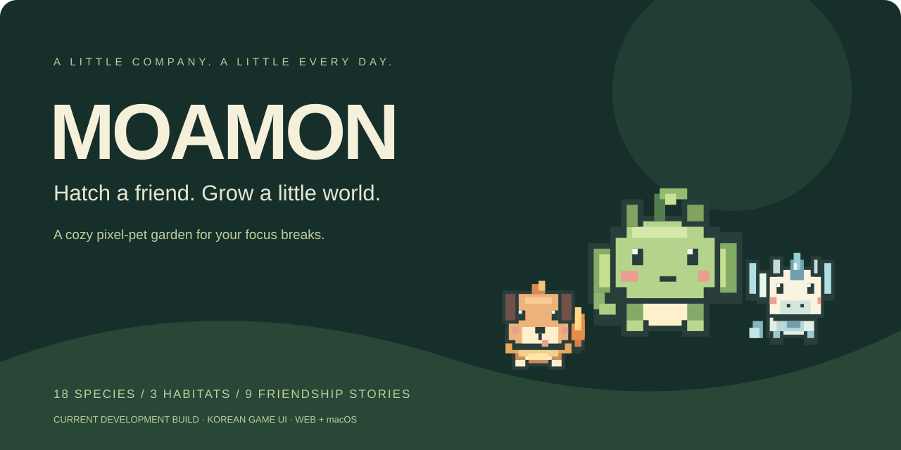
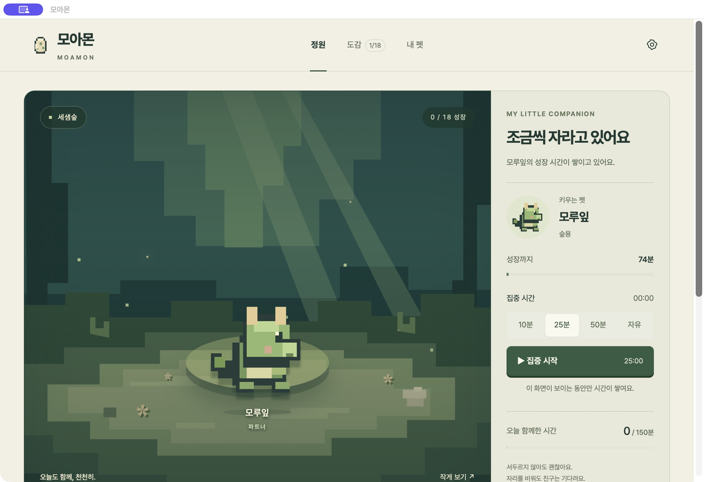
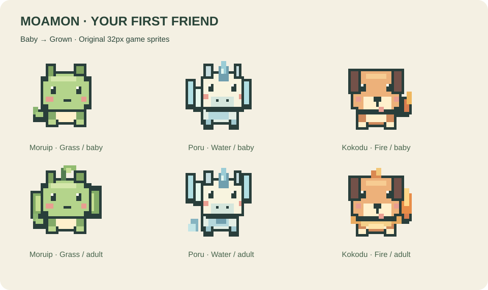
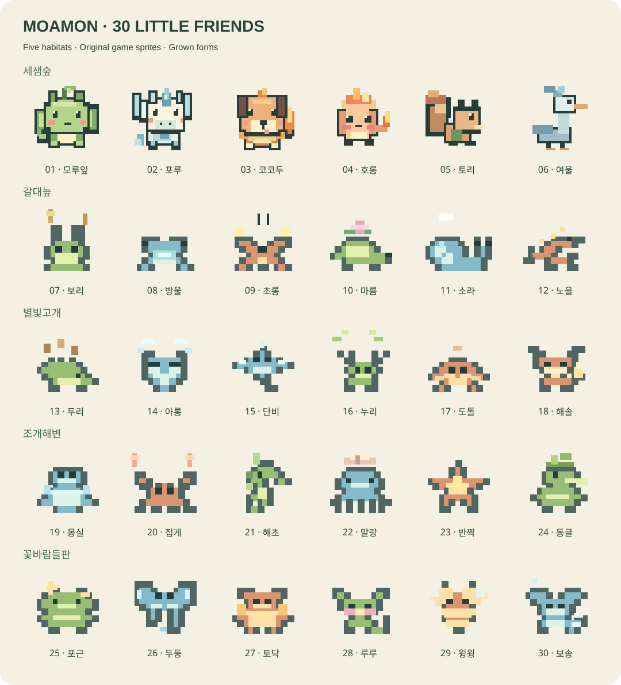
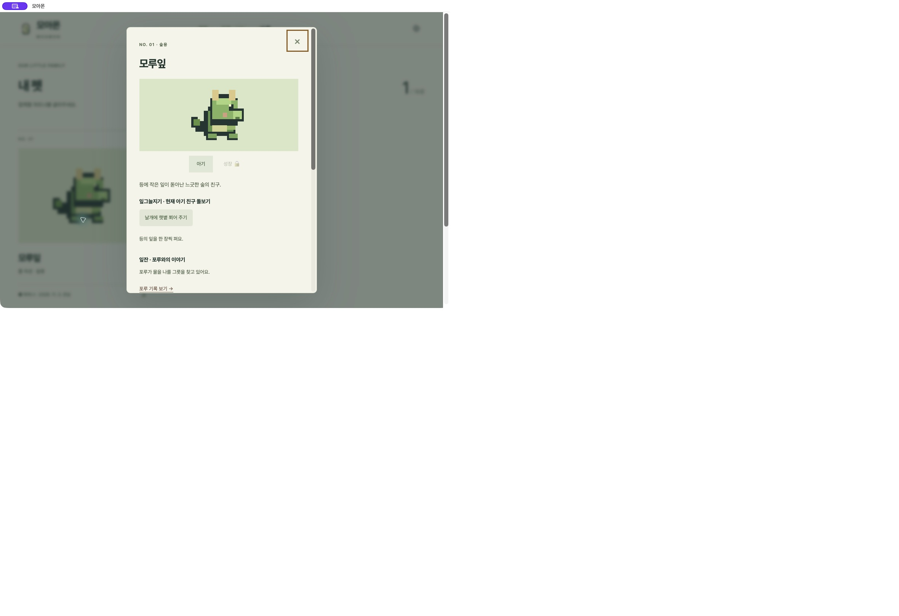

<div align="center">

[English](README.md) · [한국어](README.ko.md)

# Moamon

**Hatch a friend. Grow a little world.**

A cozy pixel-pet garden. Choose an egg, spend a little time together,<br>
and discover the friendships that make your garden feel like home.

[**Play the browser alpha ↗**](https://dayainow.github.io/lorehatch/) · [**Get Moamon ↓**](#get-moamon) · [**Give it a star ☆**](https://github.com/dayainow/lorehatch)


</div>



<p align="center"><sub>Original character artwork from the current development build. The public browser alpha is an earlier build.</sub></p>



<sub>Earlier interface capture; see the updated starter artwork below.</sub>

## Your next break has a tiny face

A leaf-winged dragon soaking up sunlight. A little Pegasus practicing its landing. An affectionate puppy with charcoal ears and a tiny ember tail.

Moamon turns a focus session into a small, visible change in a friend you chose. Your first egg hatches immediately. Keep the garden open, start a session, and watch your companion grow. When you return, there is another reaction to discover—and another friend to meet.

**Choose an egg → hatch → focus together → grow → discover a friendship.**

No hunger meter. No lost streaks. No punishment for taking a day off.

## Three eggs. Three very different friends.

- **모루잎 · Grass:** a round little forest dragon with folded leaf ears and a vine tail. Growing up reveals broad leaf wings and a fresh sprout.
- **포루 · Water:** a tiny Pegasus with a droplet forelock and rippling wings. Its wings spread wider as it grows.
- **코코두 · Fire:** an affectionate ember puppy with charcoal ears and one little face. Its tiny ember tail grows longer, and a fluffy fire ruff appears.



**Egg → baby → grown companion.** Each species currently grows once after hatching, keeping its name and identity. Branching or three-stage evolution is not implemented. Fire, water, and grass are character affinities; there is no combat system yet. [Starter design notes (Korean)](docs/27-starter-growth.md).

## A garden worth getting to know

- **30 species, 60 appearances.** Every friend has a baby and grown form, a personality, and something they love. Growth stages count as one species.
- **Five connected habitats.** Raise the six residents of one habitat to unlock the next set of eggs. Preview the whole collection in the field guide.
- **Fifteen little friendship stories.** Raise and care for both friends in a pair to discover their shared ending. Your next egg suggestions help you find the missing friend.
- **Care with character.** Warm a leaf-wing in the sun, brush seeds from a rabbit’s ears, or leave a stepping stone by the water. Baby and grown friends respond differently.
- **A companion on your Mac.** Keep your selected partner on screen, drag it to a comfortable spot, and open its care menu with a click.



<p align="center"><sub>Current development roster. The long-term goal is 120 species; 30 are implemented today.</sub></p>

## A collection beyond the creatures

The current development build adds **30 choice-based encounters**, **30 memory cards**, and **12 collection milestones**. Meet a friend in the garden, choose a small way to help, and keep the moment in your memory journal. Owned friends remain available at any time; there are no missed-day penalties or duplicate card rewards.

## Small gestures. Shared stories.

The leaf dragon can make a cup from its wings. The Pegasus can carry the water. Together, they have something neither could make alone.

The field guide records each friend’s care reactions and the progress of their shared story. Care is optional, and repeated clicks do not speed up growth. The reward is getting to know your companions.



<sub>Earlier local Mac alpha capture, before the starter artwork update. The game interface is currently Korean; this README is available in English and Korean.</sub>

## Get Moamon

### Play in your browser

[**Open the public alpha**](https://dayainow.github.io/lorehatch/) · [**Try the fast-growth demo**](https://dayainow.github.io/lorehatch/?mode=demo)

No account required. The demo uses separate progress. **The public alpha is an earlier build and does not include all the features pictured above.**

### Download and build the current project

[**Download source ZIP**](https://github.com/dayainow/lorehatch/archive/refs/heads/main.zip) · [**Check GitHub Releases**](https://github.com/dayainow/lorehatch/releases)

**There is no public prebuilt app release yet.** The source ZIP contains the published branch, which can lag behind development. It is source code, not a one-click installer. Current local macOS packages support Apple Silicon and Intel on macOS 13+, but Developer ID signing and notarization remain unfinished. Moamon is not listed in the Mac App Store or Chrome Web Store.

To run the published source, install Node.js 22+ and use:

```sh
git clone https://github.com/dayainow/lorehatch.git
cd lorehatch
npm run dev
```

Open [localhost:4173](http://127.0.0.1:4173/). No npm dependencies are required to run the game. Stop with `Ctrl+C`.

<details>
<summary><strong>Build the current checkout for web or Mac</strong></summary>

```sh
npm test
npm run check
npm run build
npm run package:web
```

`dist/` contains the static site. The web packaging command requires `zip` and `unzip`.

On a Mac with Xcode Command Line Tools:

```sh
npm run package:mac
```

The app is written to `build/desktop/Lorehatch.app`, with a universal ZIP in `release/`. `lorehatch` is the repository and internal bundle name; the product is Moamon. Packaging uses ad-hoc signing, not Developer ID signing or notarization.

</details>

## Your first few minutes

1. **Pick your first friend.** Choose a fire, water, or grass egg and confirm its instant hatch.
2. **Start a focus session.** Choose 10, 25, or 50 minutes—or an open-ended session.
3. **Visit the field guide.** Open your friend and try its care action. Come back after growth for a different reaction.
4. **Keep a memory.** Open the memory journal, meet an owned friend, and choose how to help. A wrong choice costs nothing; try again.
5. **Find its friend.** Check the relationship hint and choose the next egg when it becomes available.

The normal garden uses 25 minutes to hatch later eggs and 75 minutes to grow a baby, with up to 150 minutes credited per day. The fast demo uses 15 seconds to hatch and 30 seconds to grow. These values are still being playtested.

**Manual focus time accrues while the garden view is visible and a session is running.** Hiding the garden, switching away from the browser tab, or locking the screen pauses progress. A floating desktop pet does not mean background focus time is being counted.

<details>
<summary><strong>Quick guide to the Korean buttons</strong></summary>

- **첫 알 고르기** — Choose your first egg
- **집중 시작** — Start focusing
- **성장한 모습 보기** — Reveal the grown form
- **도감** — Field guide
- **내 펫** — My pets
- **추억** — Memory journal
- **정원 설정** — Garden settings
- **파일 내보내기 / 파일 가져오기** — Export / import progress

</details>

## Make room on your desktop

In the Mac build, click your floating companion for care, size, and visibility options. Drag to move it; double-click to open the garden. Position and size are remembered.

Lost your friend? Open garden settings and use the desktop companion controls to bring it back to the bottom-right of your screen. The menu bar also lets you reopen the garden and show or hide the pet.

## Your garden stays yours

Progress is stored locally in the browser or Mac app. There is no automatic cloud sync. Export your progress before moving browsers, devices, or app installations, then import it into the same mode on the new installation.

Moamon does not collect task contents, keystrokes, or clipboard data, and includes no analytics tracking. Hosting providers may process ordinary access logs. Share cards include collected pets and growth counts, without nicknames or focus time.

## Grow alongside your AI work · experimental

The current local Mac build includes an **experimental Claude Code completion hook**. With the Mac app running, the first egg hatched, the setting enabled, and the hook configured, new completion signals grant one growth minute per minute bucket, without reading conversations or token counts. It requires a one-time hook setup and is not yet validated with live Claude Code sessions. [Setup and limitations](docs/24-ai-activity.md). Manual focus remains available.

[Design and launch plan (Korean)](docs/23-ai-companion-and-launch.md). Inspired by the clear connection between AI usage and desktop companionship in [PokeTokenBar](https://github.com/chattymin/PokeTokenBar), with Moamon’s own creatures and friendship stories.

## Help this little world grow

If you would like more tiny companions on your desk, **[star Moamon on GitHub](https://github.com/dayainow/lorehatch)**. It helps others discover the project and tells us this is a world worth growing.

Tried the alpha? Tell us which friend you chose, where you got stuck, or what made you want another egg. [Report a bug or suggest an idea](https://github.com/dayainow/lorehatch/issues). English and Korean feedback are welcome. Include your platform, game mode, and reproduction steps; keep private save files out of public issues.

Near-term priorities are broader Mac interaction testing, English game UI, and a publicly downloadable Mac alpha. The 120-species collection is a longer-term goal, not the current release size.

## Development snapshot · November 5, 2026

The local v0.6.0 build includes the redesigned starters, all 30 species, the memory journal, desktop companion controls, and the experimental AI hook. The 30-species expansion is source-verified; a fresh Mac GUI pass is still needed. These changes are not a public release announcement.

- **Verified:** 37 automated tests passed; the previous 18-species Mac build was checked for a complete memory encounter and journal recording, care persistence, and companion visibility and sizing.
- **Still to validate:** live Claude Code integration, all 30 encounters in the GUI, and broader multi-monitor and long-running Mac behavior. Signing and notarization for public distribution remain unfinished.

[Memory journal implementation notes (Korean)](docs/26-memory-journal.md) · [AI setup and limitations](docs/24-ai-activity.md).

## Credits and project status

Moamon is an independent alpha project. Its sprites are original, code-authored pixel assets. Folklore references and fictional adaptations are documented separately. [Source and rights notes](docs/07-sources-rights.md) · [World and care design](docs/22-world-and-care.md) · [Installation notes](docs/17-install.md) (Korean).

Pretendard is distributed under its [SIL Open Font License](assets/fonts/OFL.txt). A project-wide license has not been selected; public source access does not grant general redistribution rights to the code or characters. Moamon is a working name, not a claim of trademark clearance.

README presentation references: [VS Code Pets](https://github.com/tonybaloney/vscode-pets) for a short introduction and quick-start flow, and [Desktop Pet / eSheep](https://github.com/Adrianotiger/desktopPet) for platform-specific download clarity. No artwork, sprites, or prose were copied.

---

<p align="center"><strong>One egg. One little friend. A reason to come back.</strong><br><br><a href="https://dayainow.github.io/lorehatch/">Play the alpha</a> · <a href="https://github.com/dayainow/lorehatch">Star Moamon</a> · <a href="README.ko.md">한국어로 읽기</a></p>
