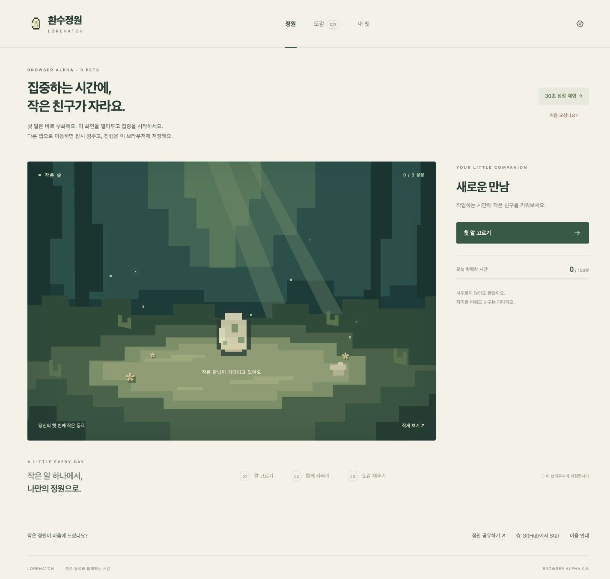

# 환수정원 · Lorehatch 🌱

**작은 알에서 시작하는, 나만의 도트 펫 정원.**

알을 고르고, 집중 시간을 쌓고, 세 친구의 아기와 성장한 모습을 도감에 모으세요. 첫 알은 기다림 없이 바로 부화합니다.



**v0.5 브라우저 알파 · 공개 배포 준비 중**

[GitHub에서 Star로 응원하기](https://github.com/dayainow/lorehatch) · [사용 후기·문제 제보](https://github.com/dayainow/lorehatch/issues)

온라인 체험 주소는 배포 확인 후 추가합니다. 현재 저장소의 공개 여부에 따라 외부 방문자의 GitHub 접근이 제한될 수 있습니다.

## 어떤 정원인가요?

- **세 친구, 여섯 모습.** 숲용·페가수스·케르베로스 모티프의 펫 3종, 아기와 성장 단계.
- **짧게 먼저 체험.** 빠른 체험은 첫 부화 즉시, 성장 30초. 일반 정원과 별도로 저장됩니다.
- **내 브라우저에 보관.** 계정 없이 시작하고, JSON 파일로 진행을 내보내거나 복구합니다.
- **내 펫과 파트너.** 별명, 파트너 선택, 소품, 동작 줄이기, 작은 화면 모드.
- **함께 나누기.** 모은 펫을 이미지로 저장하거나 정원 링크를 공유합니다. 공유 카드에는 별명과 집중 시간이 포함되지 않습니다.

브라우저 알파는 **정원 화면이 보일 때만** 적립합니다. 다른 탭으로 이동하거나 화면을 잠그면 멈추며, 돌아와서 집중 시작을 누르면 이어집니다. 일반 정원은 부화 25분·성장 75분·하루 150분까지입니다. 밸런스는 실험 중입니다.

## 로컬에서 시작하기

Node.js 22 이상. 외부 패키지 설치 없이 실행합니다.

```sh
git clone https://github.com/dayainow/lorehatch.git
cd lorehatch
npm run dev
```

- 일반 정원: http://127.0.0.1:4173/
- 빠른 체험: http://127.0.0.1:4173/?mode=demo
- 종료: 실행 터미널에서 Ctrl+C. 포트 충돌: `PORT=4174 npm run dev`

브라우저·기기·주소(포트)가 달라지면 별도 정원입니다. 이전하기 전에 **설정 → 파일 내보내기**, 새 정원의 같은 모드에서 **파일 가져오기**를 사용하세요. 브라우저 데이터를 지우면 로컬 진행도 사라집니다.

## 개발·검증

```sh
npm test
npm run check
npm run build
```

의존성 없는 ES 모듈·HTML·CSS를 사용합니다. `dist/`는 정적 호스팅용 결과물이며 HTTP(S)로 열어야 합니다. 하위 경로 호스팅을 지원합니다.

- [구현 범위와 다음 단계](docs/12-prototype.md)
- [실행한 검증과 남은 검증](docs/13-validation.md)
- [공개·배포 절차와 소개 문구](docs/14-launch.md)

GitHub Actions는 push와 PR에서 검증합니다. Pages 배포는 `Publish browser alpha` 워크플로를 수동 실행합니다. 공개 전환과 Pages 설정 후 실제 배포 주소를 확인해야 합니다.

## 의견을 들려주세요

첫 알을 고르거나 집중을 시작할 때 헷갈린 점, 다음 펫도 키워보고 싶은지 알려주세요. 문제 제보에는 브라우저·기기·일반/체험 모드·재현 순서를 적어주세요. 별명과 저장 파일은 공개 이슈에 올리지 마세요.

앱에는 분석 추적 도구가 없으며 작업 내용·키 입력·클립보드를 수집하지 않습니다. 집중 시간은 로컬에서 계산하고, 공유는 사용자가 버튼을 눌렀을 때만 요청합니다. 호스팅 제공자는 접속 로그를 처리할 수 있습니다.

## 진행 방향과 권리

다음 검증은 macOS 호스트, 다른 앱에서 작업 중 적립, 수면·복귀, 원자적 파일 저장입니다. 3종 경험을 검증한 뒤 10종 확장을 검토합니다. 재미·생산성 향상이나 고객 검증을 완료했다는 뜻은 아닙니다.

환수정원·Lorehatch와 캐릭터 이름은 작업명입니다. 이름 검색은 상표 등록 가능성 확인이 아닙니다. 스프라이트는 직접 작성한 SVG 픽셀 에셋이며 [기존 콘셉트 이미지](assets/concepts/pixel-direction-v1.png)는 참고용입니다.

라이선스 미선정. 저장소 공개가 코드·문서·캐릭터의 자유 재배포를 허용하지는 않습니다. [출처·권리 기록](docs/07-sources-rights.md)을 참고하세요.

기획 기록: [제품](docs/04-product.md) · [도감](docs/03-bestiary.md) · [용어](docs/11-language.md) · [기술](docs/09-technical.md) · [로드맵](docs/06-roadmap.md)
