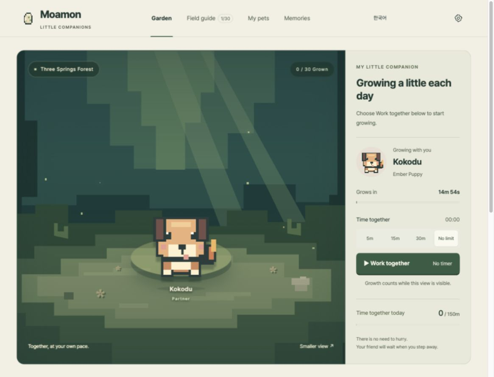
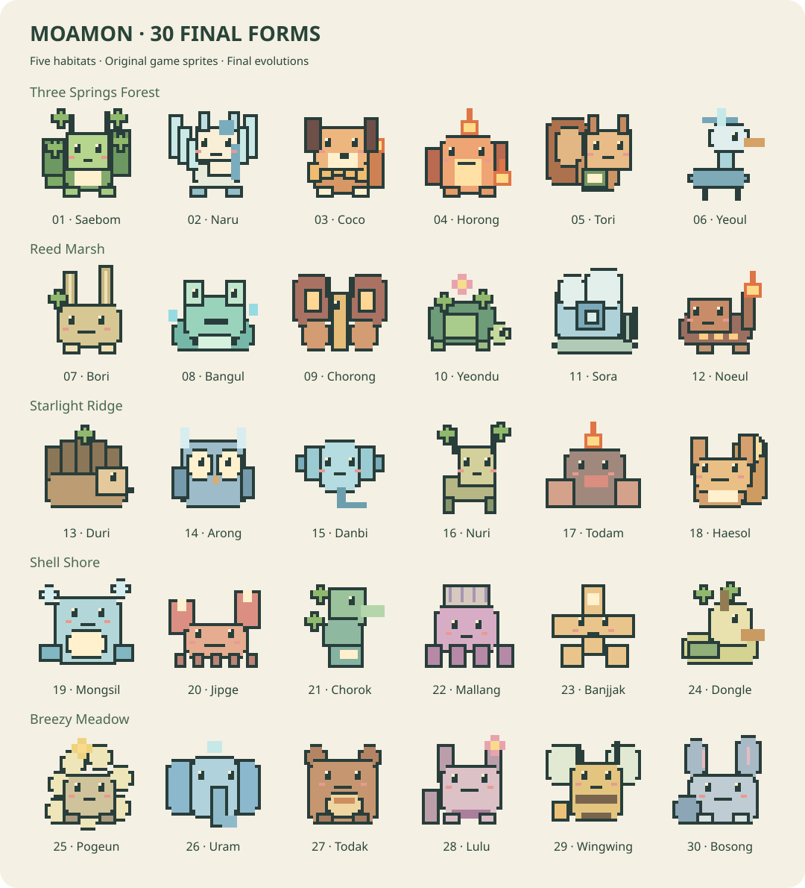

<div align="center">

**English** · [한국어](README.ko.md)

# Moamon

**A little friend grows while you work.**

Hatch a pet. Work together. Discover three forms and a garden of little stories.

[**Play in English ↗**](https://dayainow.github.io/lorehatch/?lang=en) · [**30-second demo**](https://dayainow.github.io/lorehatch/?lang=en&mode=demo) · [**Star on GitHub ☆**](https://github.com/dayainow/lorehatch)

**30 species · 3 forms each · Desktop pet · English & Korean**

</div>

> This README describes the current source and local Mac build. The hosted web alpha may be an earlier version; pushing source does not publish it automatically.



## Your next break has a tiny face

Saebom unfolds its leaf wings in the sun. Naru practices a careful landing. Coco greets your hand with a warm little nose.

Your first egg hatches immediately. Choose **Work together** and keep the garden visible: your pet is ready to evolve in **15 minutes**. Later eggs hatch in **5 minutes**. There is no hunger meter, lost streak, or penalty for taking a day off.

**Egg → baby → first evolution → final form.**

Your first evolution takes **15 minutes** together. In **My pets**, choose **Raise the final form**, then work together for another **30 minutes**. Existing evolved pets can continue from their current form. The demo uses **30 seconds + 60 seconds** after hatching.

## A pet with a little personality

Your garden pet breathes, looks around, and gets sleepy while idle. During focus it gives a quiet nod. Click it for a hop, a nuzzle, or a happy wiggle. The desktop pet reacts while keeping its click-to-focus controls.

All 30 species and all three forms share these body motions. Motion reduction is supported. Individual tail, wing, and paw animations are still planned.

## Thirty friends. Five places to call home.

- **30 species, 90 appearances.** Every friend has a baby, first evolution, and final form. An evolution stage is not a separate species.
- **Five connected habitats.** Grow the six residents of each habitat to unlock the next: Three Springs Forest, Reed Marsh, Starlight Ridge, Shell Shore, and Breezy Meadow.
- **15 friendship stories.** Grow and care for both friends in a pair to discover their shared ending.
- **30 memory cards.** Help a friend in a short choice-based encounter. Wrong choices have no penalty.
- **14 milestones.** Earlier collection achievements remain earned as you discover the expanded garden.



The longer-term ambition is 120 species. **This alpha contains 30**, each with two evolutions after hatching. Combat and branching evolution are not implemented.

## Start in a minute

1. [Open the English garden](https://dayainow.github.io/lorehatch/?lang=en) and choose a fire, water, or grass egg.
2. Hatch your friend, then choose **Work together**. **No limit** keeps the session going until you pause or evolution is ready.
3. Open the field guide to discover its care reaction. Visit Memories for its little request.
4. Select **Evolve** to compare all three forms. You can revisit them in **My pets** and the field guide.

The [quick demo](https://dayainow.github.io/lorehatch/?lang=en&mode=demo) uses a separate save, with 15-second hatching and 30-second first evolution and 60-second final evolution. Regular growth is capped at 150 credited minutes per day.

**On a phone**, use the bottom controls to hatch, care, or start and pause growth, even while looking through the field guide. Supported mobile browsers keep the screen awake during an active session.

Web growth pauses when you switch tabs or lock the screen. On macOS 14+, the native app can keep a session running with the garden window closed. Sleep pauses the session.

## Pick your language. Keep your garden.

Use the language button at the top to switch between English and Korean. Navigation, the field guide, care reactions, encounters, memories, and settings follow your choice. Your progress and personal nicknames stay unchanged. The first visit follows your browser language; a `lang=en` or `lang=ko` link takes priority.

## Play, download, or build

[**Browser alpha**](https://dayainow.github.io/lorehatch/?lang=en) · [**Release downloads**](https://github.com/dayainow/lorehatch/releases) · [**Source ZIP**](https://github.com/dayainow/lorehatch/archive/refs/heads/main.zip)

The browser is the primary public alpha. The web ZIP is a static-site bundle for local hosting, not a desktop installer. The source ZIP contains source code.

**Mac development build:** click the desktop pet to start or pause focus, double-click to open the garden, or right-click for care and size controls. The menu bar also starts or pauses focus. On macOS 14+, a running session continues with the garden window closed. Use Shift–Command–F when Moamon is active, or the desktop pet and menu bar while in another app. Local universal packages target macOS 13+ on Apple Silicon and Intel. They are ad-hoc signed, **not Developer ID signed or notarized**, and are not presented as a ready-to-install public Mac release. Moamon is not listed in an app store.

To run the source with Node.js 22+:

```sh
git clone https://github.com/dayainow/lorehatch.git
cd lorehatch
npm run dev
```

Open [localhost:4173](http://127.0.0.1:4173/?lang=en). No runtime npm dependencies are required.

<details>
<summary>Build and verify</summary>

```sh
npm test
npm run check
npm run build
npm run package:web
```

The site is written to `dist/`; the web ZIP is written to `release/`. Packaging needs `zip` and `unzip`.

On macOS with Xcode Command Line Tools:

```sh
npm run package:mac
```

The application is written to `build/desktop/Lorehatch.app`. `lorehatch` remains the repository and internal bundle identifier; the product is Moamon.

</details>

## Your garden stays yours

Progress stays on your device. There is no account or automatic cloud sync. Export progress in settings before moving devices, browsers, or app installations, and import it into the same mode.

Moamon does not collect task content, keystrokes, or clipboard data and includes no analytics. Hosting providers may process ordinary access logs. Share cards omit nicknames and session time.

The local Mac build also includes an **experimental Claude Code completion hook**. It reads completion timestamps, not conversations or token counts. It needs explicit setup; live-provider validation remains unfinished. [Setup and limitations](docs/24-ai-activity.md).

## Alpha status

The latest local verification passed **46 tests**, checked idle/focus rendering and desktop sprite selection for all **90 forms**, and loaded all **182 frames** through the native pixel parser. Universal Mac packaging, signature integrity, and save/recovery self-tests passed. These are development builds; individual motion playback has not been visually tested for every form.

The automated checks cover growth, save recovery and migration, collection completion, care, memories, offline navigation, and translation coverage. Browser checks cover English hatching, care, memory collection, language switching, and field-guide browsing. These checks do not establish customer validation or full device coverage.

Before a general Mac release, Developer ID signing, notarization, broader native playtesting, and live AI integration testing remain.

Found a problem or a friend you would love to meet? [Open an issue](https://github.com/dayainow/lorehatch/issues) with your platform and reproduction steps. Please keep private save files out of public issues.

## Credits

Sprites are original, code-authored pixel artwork. Traditional motifs and fictional garden adaptations are documented separately. No third-party game artwork or sprites are included. Pretendard is distributed under the [SIL Open Font License](assets/fonts/OFL.txt).

The repository has no project-wide open-source license. Public access is not a grant to redistribute its code or characters. Moamon is a working name, not a claim of trademark clearance.

Presentation references include [VS Code Pets](https://github.com/tonybaloney/vscode-pets), [Desktop Pet](https://github.com/Adrianotiger/desktopPet), and [PokeTokenBar](https://github.com/chattymin/PokeTokenBar). Their artwork and prose were not copied.

---

**One egg. One little friend. A reason to come back.**
