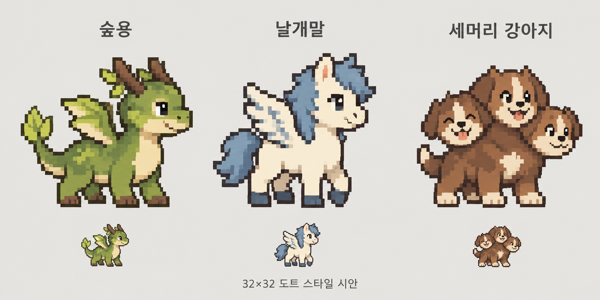

# 환수정원 · Lorehatch

> 작업하면서 펫을 키우고, 도감을 채우세요.

**기획 v0.3 · 2026-10-27 · 브랜드 작업명 / 앱 개발 전**

알을 품고, 도트 환수를 키우고, 나만의 도감을 채우는 작은 데스크톱 보호구역입니다. 익숙한 판타지 생물과 세계의 전승을 독자적인 도트 캐릭터로 표현합니다.

이미지는 사용자가 선호한 **도트풍 콘셉트**입니다. 이미지 내 32×32 표기는 목표 스타일이며, 실제 32×32 투명 스프라이트나 완성 애니메이션이 아닙니다.

## 제품의 중심

**알 선택 → 함께 작업하며 부화 → 아기 환수 성장 → 도감 등록 → 다음 알.**

성장한 환수는 정원에 남고, 언제든 동료로 선택합니다. 탐방·전투·교배는 초기 범위에서 제외합니다. 신화 설명은 읽고 싶은 사람만 펼치며, 기본 화면은 쉽고 짧은 이름을 사용합니다.

- 첫 시제품 / MVP: 숲용·페가수스·케르베로스 3종, 종별 아기/성장 2형태.
- 1차 콘텐츠 목표: 10종. 드래곤·그리스·동아시아·북유럽·이집트 컬렉션. MVP와 구분.
- 제작 목표: 32×32, 종별 제한 팔레트, 한 방향, 대기 2프레임. 가독성 검증 후 규격 확정.
- 기본 애니메이션 제작량: 3종 × 2형태 × 2프레임 + 공통 알 2프레임 = 14프레임. UI·배경·효과음은 별도.
- 플랫폼: macOS 우선. React+TypeScript 공통 UI, Tauri 호스트는 기술 검증 후보.
- 성장 원천: 사용자가 시작한 집중 시간. AI 토큰 소모·작업 내용 감시·상시 서버 불필요.
- 다음 단계: 정확한 도트 3종을 정리한 뒤 알에서 첫 환수까지 작동하는 작은 시제품.

## 기획 문서

1. [브랜드·쉬운 이름](docs/01-brand.md)
2. [통합 세계관과 알](docs/02-world.md)
3. [첫 도감 10종](docs/03-bestiary.md)
4. [제품·화면·성장 규칙](docs/04-product.md)
5. [사업·검증·수익화](docs/05-business.md)
6. [개발 순서·완료 기준](docs/06-roadmap.md)
7. [출처·권리·미확인 사항](docs/07-sources-rights.md)
8. [도트 제작 규격·에셋 목록](docs/08-pixel-art.md)
9. [기술 설계·데이터·예외 처리](docs/09-technical.md)
10. [개정 결정 기록](docs/10-decisions.md)
11. [용어·UI 문구](docs/11-language.md)
12. [구조화된 도감](data/creatures.json) / [밸런스 가설](data/balance.json)

브랜드명·가격·시간 수치는 검증할 제안입니다. 이름의 상표/도메인 등록 가능성, 앱 구현, 수익성은 검증하지 않았습니다. 저장소에는 기획·콘셉트 이미지·콘텐츠 초안만 있습니다. 외부 게임 이미지나 사용자의 참고 첨부는 저장하지 않았습니다.

라이선스 미선정. 공개 저장소 전환만으로 문서·코드·캐릭터의 자유 이용을 허용하지 않습니다.
